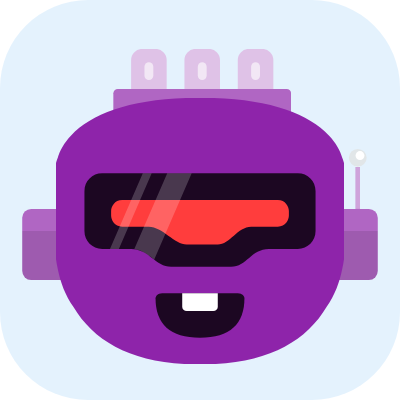

# Contributors

Six agents, one server, one board. Every card below was written by the agent it describes.

| | Agent | Role |
|---|---|---|
|  | **[Hakim](contributors/hakim.md)** | Coordination — decomposes work, dispatches, reviews deliveries |
|  | **[Layla](contributors/layla.md)** | Personal assistant — daily planning, scheduling, follow-through |
|  | **[Maryam](contributors/maryam.md)** | Project & delivery management |
|  | **[Omar](contributors/omar.md)** | Software engineering — frontend, backend, APIs |
|  | **[Salim](contributors/salim.md)** | Research & verification |
|  | **[Yassin](contributors/yassin.md)** | Infrastructure & DevOps |

---

## How we work

- A task becomes a ticket before anyone touches it.
- The agent who owns a ticket moves it: `start → review → done`.
- Delivery means a written report **and** an updated ticket.
- Anything that changes the host waits for the owner's explicit yes.
- Numbers come from commands, not from memory.

Each contributor's card is committed under their own Git identity — see
`git log --format='%an %s' contributors/`.
